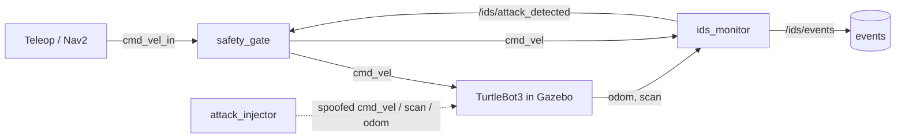

# ROS 2 Robot Intrusion Detection

[](../../actions/workflows/ci.yml)

Detecting cyber attacks on a ROS 2 mobile robot and bringing it to a safe stop.

ROS 2's default transport (DDS) has no authentication: any process on the same
network and domain ID can publish velocity commands or fake sensor data. This
project injects realistic attacks into a simulated TurtleBot3 and detects them
with lightweight, physics-aware checks, building towards a learned detector in
the spirit of industrial control-system intrusion detection
([Ahmad, Mansoor et al., *Expert Systems with Applications*, 2026](https://doi.org/10.1016/j.eswa.2025.130463)).

## How it works



* **`ids_monitor`** watches `/cmd_vel`, `/odom` and `/scan`, inspects the ROS
  graph for unexpected publishers, and latches `/ids/attack_detected` on the
  first alert. Reset it with `ros2 service call /ids/reset std_srvs/srv/Trigger`.
* **`safety_gate`** is the only node meant to drive the robot. It forwards
  commands from `cmd_vel_in` and, once the alarm is raised, blocks them and
  publishes zero velocity. After the alarm is cleared it waits for a stop
  command (press `s` in teleop) before it forwards motion again, so a reset
  never restarts the robot by itself.
* **`attack_injector`** plays the attacker.

| Attack | What the attacker does | Detected by |
|---|---|---|
| `cmd_vel_spoof` | Publishes its own velocity commands | unexpected publisher, competing command streams, command/odometry mismatch |
| `scan_spoof` | Publishes fake LiDAR scans of a nearby wall | scan rate, scan discontinuity, publisher count |
| `odom_replay` | Replays recorded odometry with old timestamps | stamps going backwards, impossible jumps |
| `flood` | Sends commands at ~1 kHz (DoS) | message rate, competing command streams |

The detectors live in [`robot_ids/detectors.py`](robot_ids/robot_ids/detectors.py)
and have no ROS imports, so they are unit-tested with plain pytest.

## Quick start

Works with ROS 2 **Humble** (Ubuntu 22.04, Gazebo Classic) and **Jazzy**
(Ubuntu 24.04, Gazebo Harmonic) plus the TurtleBot3 simulation packages; see
[docs/SETUP.md](docs/SETUP.md). The velocity message type (`Twist` on Humble,
`TwistStamped` on Jazzy) is picked automatically from `ROS_DISTRO`.

```bash
mkdir -p ~/ids_ws/src && cd ~/ids_ws/src
git clone https://github.com/Rofaiq/Ros2_Intrusion_Detection.git
cd ~/ids_ws && colcon build --symlink-install && source install/setup.bash

# Terminal 1: simulator + monitor + safety gate
ros2 launch robot_ids sim.launch.py

# Terminal 2: drive the robot through the gate
ros2 run turtlebot3_teleop teleop_keyboard --ros-args -r cmd_vel:=cmd_vel_in

# Terminal 3: readable summary of detections (first event per detector)
ros2 run robot_ids event_logger

# Terminal 4: attack, then watch the monitor stop the robot
ros2 launch robot_ids attack.launch.py attack:=cmd_vel_spoof

# Clear the alarm before the next attack, then press s in teleop to re-arm
ros2 service call /ids/reset std_srvs/srv/Trigger
```

Every injection attack adds a publisher to a topic, so the graph checks
catch it first. To see whether the data-based detectors (rates, physics and
consistency checks) catch it too, start the simulation with
`ros2 launch robot_ids sim.launch.py graph_checks:=false`.

Run the tests with `colcon test --packages-select robot_ids && colcon test-result --verbose`.

## Measuring detection

One command runs the whole experiment: a scripted driver wanders around the
world while every attack is launched 10 times (each as its own process, as a
real attacker would), after 5 minutes of attack-free driving to count false
alarms.

```bash
ros2 launch robot_ids experiment.launch.py                     # all detectors
ros2 launch robot_ids experiment.launch.py graph_checks:=false # data-based detectors only
```

It takes about 25 minutes of simulation time and writes `summary.md`,
`trials.csv` and `events.csv` to `~/ids_results/<date-time>/`. Every phase is
timed in simulation time, so on a slower computer, where Gazebo runs below
real time, the run takes longer but measures the same thing; the summary
reports the real-time factor. The attack injector publishes ground truth on
`/ids/attack_truth`, tagged with its trial, so detection delays are measured
from the moment each attack really starts. Each attacker exits when its
attack ends, and the runner refuses to start while attackers from an earlier
run are still alive (`pkill -f attack_injector` clears them).

### Results

TurtleBot3 burger in `turtlebot3_world` on ROS 2 Humble and Gazebo Classic
(laptop, simulation at 0.99x real time), 10 trials per attack, two runs.

**All detectors:**

| Attack | Detected | Median delay | Worst delay | Detectors that fired |
|---|---|---|---|---|
| `cmd_vel_spoof` | 10/10 | 0.10 s | 0.10 s | cmd_conflict (10/10), cmd_odom_consistency (10/10), publisher_allowlist (10/10), publisher_count (10/10) |
| `flood` | 10/10 | 0.10 s | 0.10 s | rate (10/10), publisher_allowlist (10/10), publisher_count (10/10), cmd_conflict (7/10) |
| `odom_replay` | 10/10 | 0.00 s | 0.00 s | odom_replay (10/10), publisher_count (10/10), rate (10/10), cmd_odom_consistency (4/10) |
| `scan_spoof` | 10/10 | 0.00 s | 0.00 s | scan_sanity (10/10), publisher_count (10/10), rate (10/10) |

**Graph checks off** (`graph_checks:=false`), so only the data-based
detectors can raise the alarm:

| Attack | Detected | Median delay | Worst delay | Detectors that fired |
|---|---|---|---|---|
| `cmd_vel_spoof` | 10/10 | 0.10 s | 0.20 s | cmd_odom_consistency (10/10), cmd_conflict (10/10) |
| `flood` | 10/10 | 0.10 s | 0.20 s | rate (10/10), cmd_conflict (8/10) |
| `odom_replay` | 10/10 | 0.00 s | 0.00 s | odom_replay (10/10), rate (10/10), cmd_odom_consistency (5/10) |
| `scan_spoof` | 10/10 | 0.00 s | 0.00 s | scan_sanity (10/10), rate (10/10) |

Each run had no false alarms in 5 minutes of attack-free driving. Delays are
in simulation time, which Gazebo Classic advances in 0.1 s steps, so 0.00 s
means detected within the same step.

How to read this:

* Every attack adds a publisher, so with the graph checks on they fire on
  every trial. The second run shows the data-based detectors catch all four
  attacks on their own, which matters against an attacker who replaces the
  legitimate node instead of adding one.
* `cmd_odom_consistency` fires with little margin (residuals of 0.15 to
  0.18 against a 0.15 threshold); `cmd_conflict` is what reliably catches
  spoofed commands.
* These attacks are deliberately crude: constant spoofed commands, replayed
  odometry with its old timestamps, and a phantom wall that appears at once.
  A careful attacker would re-stamp replayed messages or shift the scan
  gradually, which these rules are not designed to catch. That is the case
  for the learned detector on the roadmap.
* Five minutes of normal driving per run is too short to claim a low
  false-alarm rate.

## Limitations

Detection is not prevention. An attacker publishing directly on `/cmd_vel`
competes with the safety gate's stop commands, so the robot may still move.
Preventing this needs authenticated, access-controlled DDS (SROS2), which is on
the roadmap below.

## Roadmap

- [x] Attack injector, rule-based detectors, latched alarm and safety gate
- [x] Experiment runner: detection rate, false alarms and time-to-detect
- [x] Publish measured results here
- [ ] Longer attack-free baselines, and stealthier attacks (re-stamped replay, gradual scan drift)
- [ ] Record labelled datasets and train an MLP / autoencoder detector
- [ ] Autonomous navigation with Nav2 during attacks
- [ ] SROS2 access control, and a comparison of detection vs. prevention

See [docs/ROADMAP.md](docs/ROADMAP.md) for details.

## License

Apache-2.0
